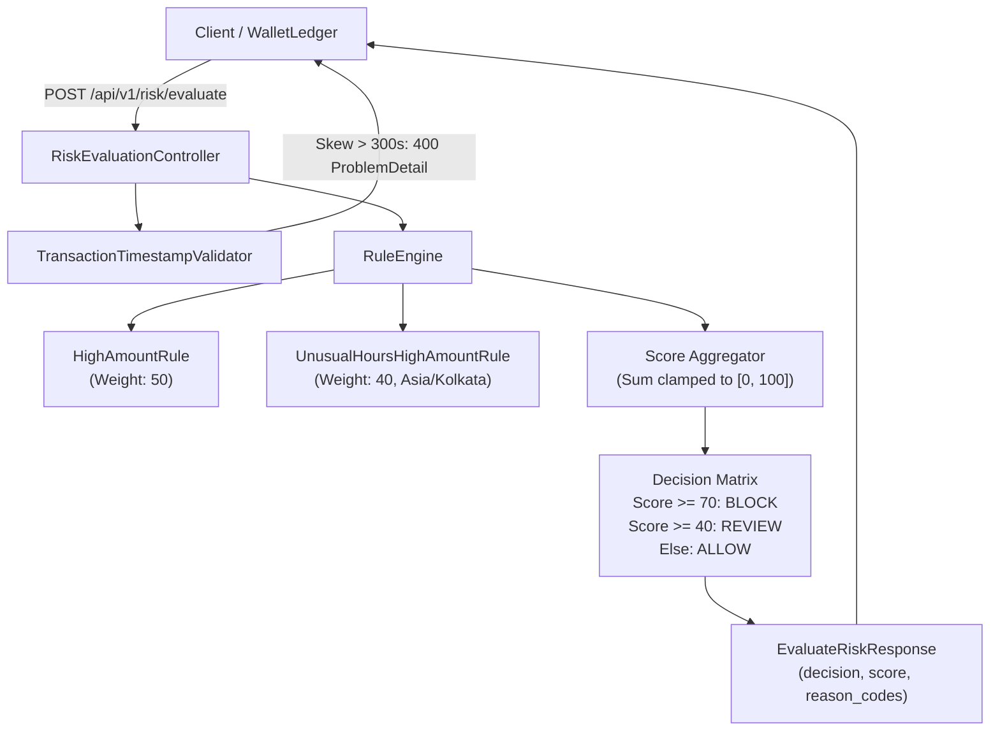

# FraudGuard

[](https://github.com/JAY1196/fraudguard/actions/workflows/ci.yml)

Real-time transaction fraud-risk scoring engine designed for financial ledgers and payment platforms (e.g., WalletLedger). Evaluates incoming transaction events through a pluggable Strategy Pattern rule engine, computes deterministic risk scores, and returns automated decisions (`ALLOW`, `REVIEW`, `BLOCK`) with standardized RFC 9457 ProblemDetail error contracts.

---

## Architecture Overview



---

## Fraud Rules Matrix

All rules implement the `FraudRule` strategy interface and are configured via typed, validated `@ConfigurationProperties` (`FraudGuardProperties`):

| Rule Name | Condition | Weight | Default Reason Code | Configurable Key |
| :--- | :--- | :---: | :--- | :--- |
| `HighAmountRule` | Transaction `amount_paise > 5,000,000` (₹50,000) | `50` | `HIGH_AMOUNT` | `fraudguard.rules.high-amount` |
| `UnusualHoursHighAmountRule` | `amount_paise > 2,000,000` (₹20,000) between `23:00` and `05:00` in configured timezone (`Asia/Kolkata`) | `40` | `UNUSUAL_HOURS_HIGH_AMOUNT` | `fraudguard.rules.unusual-hours` |

### Decision Thresholds

- **Score Calculation**: Sum of triggered rule weights, capped at `[0, 100]`. Reason codes are deduplicated and sorted deterministically.
- **Score $\ge$ 70**: `BLOCK` (Automatic rejection)
- **Score $\ge$ 40**: `REVIEW` (Flagged for operational review)
- **Score $<$ 40**: `ALLOW` (Accepted)

---

## Port Allocation

To allow simultaneous local execution alongside upstream services (e.g., WalletLedger), ports are mapped to dedicated non-conflicting numbers on localhost:

| Service | Host Port | Container Port | Binding | Notes |
| :--- | :--- | :--- | :--- | :--- |
| **FraudGuard App** | `8082` | `8082` | `0.0.0.0` / Localhost | Configured in `application.yml` |
| **PostgreSQL 17** | `5433` | `5432` | `127.0.0.1` | Localhost only, defined in `docker-compose.yml` |
| **Redis 7** | `6381` | `6379` | `127.0.0.1` | Localhost only, defined in `docker-compose.yml` |

---

## Quickstart

### 1. Prerequisites
- **Java 21** (JDK 21)
- **Docker** & **Docker Compose**

### 2. Start Infrastructure
```bash
# Copy template environment file if needed
cp .env.example .env

# Spin up PostgreSQL 17 and Redis 7
docker compose up -d

# Verify healthy status
docker compose ps
```

### 3. Build & Run Application
```powershell
# Run Maven verification (Windows)
.\mvnw.cmd clean verify

# Start the application on port 8082
.\mvnw.cmd spring-boot:run
```
*(On Linux/macOS, use `./mvnw clean verify` and `./mvnw spring-boot:run`)*

### 4. Service Verification & OpenAPI Documentation
- **Health Check**: `http://localhost:8082/actuator/health`
- **Swagger UI**: [http://localhost:8082/swagger-ui.html](http://localhost:8082/swagger-ui.html)
- **OpenAPI v3 JSON**: [http://localhost:8082/v3/api-docs](http://localhost:8082/v3/api-docs)

---

## API Usage (`curl.exe` Examples)

### 1. Happy Path — Normal Daytime Transaction (`ALLOW`)
```powershell
curl.exe -s -i -X POST http://localhost:8082/api/v1/risk/evaluate `
  -H "Content-Type: application/json" `
  -d '{\"event_id\":\"a1b2c3d4-e5f6-7890-abcd-ef1234567890\",\"source_wallet_id\":\"11111111-1111-1111-1111-111111111111\",\"destination_wallet_id\":\"22222222-2222-2222-2222-222222222222\",\"amount_paise\":50000,\"type\":\"TRANSFER\",\"currency\":\"INR\",\"timestamp\":\"2026-11-09T05:00:00Z\"}'
```
**Response (`200 OK`)**:
```json
{
  "event_id": "a1b2c3d4-e5f6-7890-abcd-ef1234567890",
  "decision": "ALLOW",
  "score": 0,
  "reason_codes": []
}
```

### 2. Multi-Rule Trigger — Overnight High-Amount (`BLOCK`)
Transaction of ₹60,000 (6,000,000 paise) executed at 02:30 IST (`21:00 UTC` previous day) triggers both `HIGH_AMOUNT` (50) and `UNUSUAL_HOURS_HIGH_AMOUNT` (40), yielding score 90 $\ge$ 70:
```powershell
curl.exe -s -i -X POST http://localhost:8082/api/v1/risk/evaluate `
  -H "Content-Type: application/json" `
  -d '{\"event_id\":\"b2c3d4e5-f6a7-8901-bcde-f12345678901\",\"source_wallet_id\":\"11111111-1111-1111-1111-111111111111\",\"destination_wallet_id\":\"22222222-2222-2222-2222-222222222222\",\"amount_paise\":6000000,\"type\":\"TRANSFER\",\"currency\":\"INR\",\"timestamp\":\"2026-11-08T21:00:00Z\"}'
```
**Response (`200 OK`)**:
```json
{
  "event_id": "b2c3d4e5-f6a7-8901-bcde-f12345678901",
  "decision": "BLOCK",
  "score": 90,
  "reason_codes": [
    "HIGH_AMOUNT",
    "UNUSUAL_HOURS_HIGH_AMOUNT"
  ]
}
```

### 3. Validation Error — Invalid UUID or Negative Amount (`400 VALIDATION_ERROR`)
```powershell
curl.exe -s -i -X POST http://localhost:8082/api/v1/risk/evaluate `
  -H "Content-Type: application/json" `
  -d '{\"event_id\":\"invalid-uuid\",\"source_wallet_id\":\"11111111-1111-1111-1111-111111111111\",\"destination_wallet_id\":\"22222222-2222-2222-2222-222222222222\",\"amount_paise\":-500,\"type\":\"TRANSFER\",\"timestamp\":\"2026-11-09T05:00:00Z\"}'
```
**Response (`400 Bad Request`, RFC 9457 ProblemDetail)**:
```json
{
  "type": "urn:problem:validation-error",
  "title": "Bad Request",
  "status": 400,
  "detail": "Invalid UUID format: Cannot deserialize value of type `java.util.UUID` from String \"invalid-uuid\": UUID has to be represented by standard 36-char representation",
  "instance": "/api/v1/risk/evaluate",
  "code": "VALIDATION_ERROR",
  "timestamp": "2026-11-09T05:45:00.000Z"
}
```

### 4. Timestamp Out of Range — Future-Dated Request (`400 TIMESTAMP_OUT_OF_RANGE`)
Requests with event timestamps more than `300s` ahead of processing server time:
```powershell
curl.exe -s -i -X POST http://localhost:8082/api/v1/risk/evaluate `
  -H "Content-Type: application/json" `
  -d '{\"event_id\":\"c3d4e5f6-a7b8-9012-cdef-123456789012\",\"source_wallet_id\":\"11111111-1111-1111-1111-111111111111\",\"destination_wallet_id\":\"22222222-2222-2222-2222-222222222222\",\"amount_paise\":50000,\"type\":\"TRANSFER\",\"timestamp\":\"2099-01-01T00:00:00Z\"}'
```
**Response (`400 Bad Request`, RFC 9457 ProblemDetail)**:
```json
{
  "type": "urn:problem:timestamp-out-of-range",
  "title": "Timestamp Out Of Range",
  "status": 400,
  "detail": "Transaction timestamp is too far in the future: 2099-01-01T00:00:00Z (processing time: 2026-11-09T05:45:00.000Z, max future skew: 300s)",
  "instance": "/api/v1/risk/evaluate",
  "code": "TIMESTAMP_OUT_OF_RANGE",
  "timestamp": "2026-11-09T05:45:00.000Z"
}
```

---

## Architecture Decision Records (ADRs)

See [DECISIONS.md](DECISIONS.md) for detailed architecture decision records:
- **ADR 001**: Event Time vs Processing Time in Temporal Fraud Rules (API perimeter validation vs event-time rule scoring)
- **ADR 002**: Strategy Pattern for Fraud Rule Execution
- **ADR 003**: Clock Injection (`java.time.Clock`) for Testability
- **ADR 004**: Validated Configuration Properties Record with Compact Invariants
- **ADR 005**: Port Allocation Isolation (8082, 5433, 6381)
- **ADR 006**: Windows Maven Wrapper Exit Code Handling
- **ADR 007**: Event Contract Alignment with WalletLedger (Snake_case, UUIDs, Canonical Transaction Types)

---

## Known Limitations & Roadmap

- **F1-A (Current)**: In-memory rule execution with stateless rules (`HighAmountRule`, `UnusualHoursHighAmountRule`).
- **F1-B (Upcoming)**: Redis sliding-window velocity counters and rapid funds-movement anomaly detection.
- **F1-C (Upcoming)**: PostgreSQL evaluation persistence, audit trail logging, and Flyway schema migrations.
- **F1-D (Upcoming)**: Kafka streaming integration for real-time ledger event ingestion.
